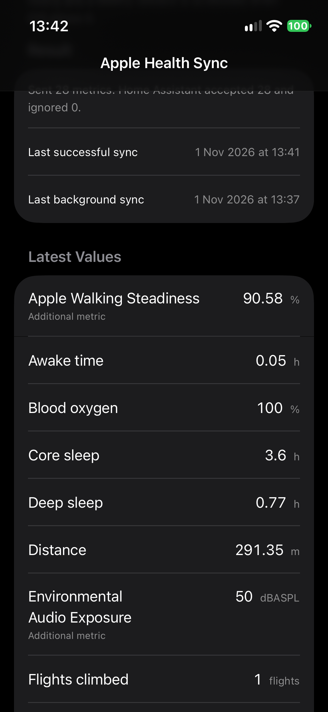

# Health Assist

[](https://github.com/sponsors/thebillington)

A free, open-source Home Assistant custom integration (HACS) plus a SwiftUI
iOS companion app that reads Apple Health and pushes it over a local webhook.

- **Local push only** — no cloud, no polling, no telemetry, no outbound calls.
- **No external Python dependencies** — runs with a stock Home Assistant.
- **Dynamic sensors** — entities appear after the first sync, with stable
  unique IDs, correct units and long-term statistics support.
- **Multi-device** — add the integration once per iPhone/iPad. Each phone gets
  its own webhook, device and entities.
- **No YAML required.**
- **Open iOS source** — SwiftUI + HealthKit app in [`ios/`](ios/), with a
  simulator-friendly test payload mode.

This repository contains both halves of the project: the Home Assistant
integration and the iOS app. The webhook contract below is the boundary
between them.

Documentation: <https://healthassist.thebillington.co.uk>.

Screenshots and generated assets live under `docs/images/`.

---

## Requirements

- Home Assistant 2024.1 or newer (tested against 2026.2 and 2026.10).
- HACS (recommended) or manual installation.
- iOS 18 or newer and Xcode 16 or newer to build the app.
- An HTTPS-reachable Home Assistant URL if the phone is not on the same LAN.
  The webhook can be used over plain HTTP on a trusted LAN, but HTTPS is
  strongly recommended because the webhook URL is a credential.

## Installation

### HACS (custom repository)

This integration is not in the default HACS store yet.

1. Open **HACS → Integrations**.
2. Select the three-dot menu → **Custom repositories**.
3. Add `https://github.com/thebillington/health-assist`
   with category **Integration**.
4. Search for **Health Assist**, install it, and restart Home Assistant.
5. Go to **Settings → Devices & services → Add integration → Health Assist**.

### Manual installation

Copy `custom_components/apple_health_sync` into your Home Assistant
`config/custom_components/` directory, then restart Home Assistant.

## Setup

1. Add the integration and give it a name, for example `Simon's iPhone`.
2. Optionally set a **shared secret**. If set, every request must include it in
   the `X-Webhook-Secret` header.
3. Choose which metrics should become entities. Leave the allow-list empty to
   enable every built-in metric.
4. Select **Submit**. The next screen shows the full webhook URL, the shared
   secret and a QR code.
5. Open the app and tap **Scan QR Code**, or scan the QR with the iPhone Camera
   from another screen. If the app already has details, it asks before replacing
   them. You can also copy the URL and secret manually. Trigger a sync. Sensors
   appear within a few seconds.

The webhook URL looks like:

```text
https://home.example.com/api/webhook/4f8c2f0e8f6d4d8bb0d7a0d3f9c1e2a7...
```

Treat the entire URL as a password. Anyone who has it can POST data to that
config entry. The optional shared secret adds a second factor.

To use two phones, add the integration twice. Each entry has a separate URL,
device and set of entities.

### Changing settings later

Open the integration entry → **Configure**. The current webhook URL is shown as
a read-only field, followed by the secret, QR code and metric allow-list. You can
change the shared secret and allow-list without changing the URL. Scan the QR
with the app's **Scan QR Code** button (or the iPhone Camera) to reconfigure.
Save and reopen the dialog after changing the secret to refresh the QR. The entry
reloads after saving; sensors return after the app's next sync.

> Removing a metric from the allow-list stops new values from being accepted,
> but Home Assistant may keep the old entity registry entry. Delete it manually
> under **Settings → Devices & services → Entities** if you want it gone.

---

## iOS app

The companion app lives in [`ios/`](ios/) and is built from this same
repository.



1. Open `ios/AppleHealthSync.xcodeproj` in Xcode.
2. Select the `AppleHealthSync` scheme and an iPhone simulator or device.
3. For a physical device, choose your development team under **Signing &
   Capabilities** and change the bundle identifier if needed.
4. Run the app, tap **Scan QR Code** under **Home Assistant**, or paste the
   webhook URL and secret, then tap **Request Health Access** and **Sync Now**.

The app merges overlapping sleep samples and sends the latest values plus
today's activity totals. On a physical iPhone it registers HealthKit observer
queries with hourly background delivery, and queues a weekly `BGTaskScheduler`
fallback. iOS decides when background work actually runs, so neither path is a
guaranteed fixed-time cron schedule. The app also has a **Send a Test Payload**
button that does not need HealthKit, so it can verify the URL, secret and
network path in the iOS Simulator.

HealthKit does not expose identifiers for muscle mass, bone mass, body water or
basal metabolic rate. The server still supports those sensors for other data
sources; the app sends basal energy burned as the generic
`basal_energy_burned` metric instead. Workouts and ECG are not in v1.

The app has been run in the iOS 27.2 simulator and verified end-to-end against
Home Assistant 2026.10.4: the test payload created the weight, body fat, steps,
heart rate, sleep total and generic blood-glucose sensors with the expected
units. Real HealthKit data still requires a physical iPhone.

See [`ios/README.md`](ios/README.md) for the full app notes, limitations and
signing instructions.

---

## Webhook contract

### Endpoint

```http
POST /api/webhook/<webhook_id>
Content-Type: application/json
X-Webhook-Secret: <optional shared secret>
```

### Payload

```json
{
  "device_id": "iphone-abc123",
  "device_name": "Simon's iPhone",
  "timestamp": "2026-10-30T08:15:00Z",
  "metrics": {
    "weight": { "value": 72.4, "unit": "kg" },
    "steps": { "value": 8432, "unit": "steps" }
  }
}
```

Historical samples use the same endpoint with a `history` object:

```json
{
  "device_id": "iphone-abc123",
  "history": {
    "weight": [
      { "timestamp": "2026-10-29T08:00:00Z", "value": 72.0, "unit": "kg" },
      { "timestamp": "2026-10-30T08:00:00Z", "value": 72.4, "unit": "kg" }
    ]
  }
}
```

| Field | Required | Description |
| --- | --- | --- |
| `metrics` | No* | Live snapshot keyed by metric name. Maximum 256 metrics per request. |
| `metrics.<key>.value` | Yes | Finite JSON number (not a string or boolean). |
| `metrics.<key>.unit` | No | String, 1–32 characters. Falls back to the registry unit for known metrics. |
| `history` | No* | Object keyed by metric name, each value an array of timestamped samples. Maximum 2,000 samples per request. |
| `history.<key>[].timestamp` | Yes | ISO 8601 timestamp. |
| `history.<key>[].value` | Yes | Finite JSON number. |
| `history.<key>[].unit` | No | Falls back to the registry unit for known metrics. |
| `device_id` | No | Stable app/device identifier. Stored as a sensor attribute. |
| `device_name` | No | Human-readable device name. Stored as a sensor attribute. |
| `timestamp` | No | ISO 8601 timestamp. Stored as the `last_sync` attribute for live metrics. |

\* Provide at least one of `metrics` or `history`.

Notes:

- `device_id` and `device_name` are metadata only. The Home Assistant device is
  derived from the config entry, not from the payload.
- `timestamp` does **not** backdate the live sensor state. The state is
  recorded at receipt time; the app timestamp is exposed as `last_sync`.
  Historical values are imported separately as long-term statistics.
- Keys are slugified (`body fat` → `body_fat`) and bounded to 64 characters
  before they are used. Keys that cannot be slugified are ignored.
- Unknown metric keys are accepted and create a generic sensor using the
  payload unit. They are logged at debug level.
- Known metrics outside the configured allow-list are accepted but ignored,
  and counted in the response's `ignored` field.
- Unknown metrics are always exposed, even when an allow-list is configured.
  This lets the app add new Apple Health categories without an integration
  update. If you need a strict allow-list, use a reverse proxy or a network
  rule to restrict the webhook.
- The maximum request body is **256 KB**. Larger requests receive `413`.
- Historical samples are grouped into UTC-hour buckets on the server. Repeated
  imports of the same hour overwrite rather than duplicate.

### Responses

| Status | Meaning |
| --- | --- |
| `200` | Accepted. Body: `{"status":"ok","accepted":2,"ignored":0}`. A payload whose metrics were all filtered is still `200`. |
| `400` | Invalid JSON, no `metrics` or `history`, an invalid sample/metric value, or too many entries. |
| `401` | The shared secret is missing or does not match. |
| `405` | A method other than `POST` was used. |
| `413` | The request body is larger than 256 KB. |

The request is validated as a whole. If any metric or history sample is
malformed, nothing from that request is stored. A history-only request returns
`{"status":"ok","accepted":N,"ignored":0,"history":{"metrics":1,"samples":123}}`.

### Example

```bash
curl -i -X POST \
  "http://homeassistant.local:8123/api/webhook/YOUR_WEBHOOK_ID" \
  -H "Content-Type: application/json" \
  -H "X-Webhook-Secret: YOUR_SECRET" \
  -d '{
    "device_id": "iphone-abc123",
    "device_name": "Simon iPhone",
    "timestamp": "2026-10-30T08:15:00Z",
    "metrics": {
      "weight": {"value": 72.4, "unit": "kg"},
      "steps": {"value": 8432, "unit": "steps"},
      "sleep_total": {"value": 7.5, "unit": "h"}
    }
  }'
```

Expected response:

```json
{"status":"ok","accepted":3,"ignored":0}
```

---

## Metric registry

All built-in sensors use `state_class: measurement`, so they are eligible for
Home Assistant long-term statistics.

| Key | Sensor name | Unit | Device class |
| --- | --- | --- | --- |
| `weight` | Weight | `kg` | `weight` |
| `bmi` | BMI | — | — |
| `body_fat` | Body fat | `%` | — |
| `lean_body_mass` | Lean body mass | `kg` | `weight` |
| `muscle_mass` | Muscle mass | `kg` | `weight` |
| `bone_mass` | Bone mass | `kg` | `weight` |
| `body_water` | Body water | `%` | — |
| `basal_metabolic_rate` | Basal metabolic rate | `kcal` | — |
| `steps` | Steps | `steps` | — |
| `distance` | Distance | `m` | `distance` |
| `active_energy` | Active energy | `kcal` | — |
| `resting_heart_rate` | Resting heart rate | `bpm` | — |
| `heart_rate` | Heart rate | `bpm` | — |
| `heart_rate_variability` | Heart rate variability | `ms` | — |
| `respiratory_rate` | Respiratory rate | `breaths/min` | — |
| `blood_oxygen` | Blood oxygen | `%` | — |
| `systolic` | Systolic blood pressure | `mmHg` | — |
| `diastolic` | Diastolic blood pressure | `mmHg` | — |
| `sleep_total` | Sleep total | `h` | `duration` |
| `sleep_deep` | Deep sleep | `h` | `duration` |
| `sleep_rem` | REM sleep | `h` | `duration` |
| `sleep_core` | Core sleep | `h` | `duration` |
| `sleep_awake` | Awake time | `h` | `duration` |
| `vo2_max` | VO2 max | `mL/kg/min` | — |
| `flights_climbed` | Flights climbed | `flights` | — |
| `stand_hours` | Stand hours | `h` | `duration` |
| `water_intake` | Water intake | `mL` | `volume` |

The canonical units are part of the contract. The app should send these units.
If it sends a different unit, that unit is used for the entity; Home Assistant
may not be able to convert it for statistics if it is not a recognised unit.

### Entity IDs

Entities are named after the config entry device and the metric. For a device
named `Simon's iPhone`, weight becomes:

```text
sensor.simon_s_iphone_weight
```

Unique IDs are stable and follow `{entry_id}_{metric_key}`, for example
`01J..._weight`. Renaming the entity does not break updates.

---

## Long-term statistics and history

Every sensor has a numeric state, a unit (where applicable) and
`state_class: measurement`, so Home Assistant records long-term statistics.

The iOS app’s first sync exports the complete HealthKit history from 2014 in
resumable chunks. The integration imports those samples as long-term statistics
under each sensor entity’s `statistic_id` — the same place the sensor’s live
statistics live. The Statistics dashboard shows the full history.

Home Assistant cannot backfill normal **state** history retroactively, so old
samples appear as long-term statistics rather than individual historical state
changes. High-frequency metrics (heart rate, HRV, oxygen, audio exposure, …) are
stored as hourly means; daily activity totals and sleep sessions are stored as
daily values. The app uses per-metric checkpoints, so an interrupted first
export resumes on the next sync. **Re-export All History** in the app resets
those checkpoints and imports everything again.

The live store remains in memory: after a Home Assistant restart, sensor states
are unavailable until the next sync, but previously imported statistics remain
in the recorder database.

If statistics do not appear immediately, wait for the recorder commit interval
and confirm the entity has a numeric state with a state class.

---

## Security

- The webhook ID is the primary secret. The full URL is a credential; do not
  paste it into public issues, screenshots or chat.
- Set a shared secret in the config flow and configure the same value in the
  app. Requests without it receive `401`.
- Put Home Assistant behind HTTPS (Nabu Casa Cloud, a reverse proxy, or a VPN)
  if the phone is outside the LAN. Do not expose plain HTTP to the internet.
- The integration intentionally does **not** set `local_only` on the webhook,
  because the phone may connect through a reverse proxy or cloud URL. If you
  want LAN-only delivery, restrict `/api/webhook/` at your reverse proxy.
- The shared secret is stored in the Home Assistant config entry (in
  `.storage`) like other integration credentials. Protect backups accordingly.
- The QR code in Configure contains both the webhook URL and the secret. Treat
  a screenshot of it like a password.
- Diagnostics redact the webhook ID, shared secret, device identifiers and all
  metric values. Metric keys, units and timestamps remain visible.
- There are no outbound network calls and no telemetry.

---

## Troubleshooting

### `401 invalid secret`

The request did not include `X-Webhook-Secret`, or the value does not match the
entry's configured secret. Re-copy the secret in the app, or clear it in
**Configure** if you do not want to use one.

### `400` responses

Check that:

- the body is valid JSON;
- `metrics` is a non-empty object (not an array or string);
- every metric is an object with a numeric, finite `value`;
- `unit`, if present, is a short string;
- there are no more than 256 metrics.

### `413 payload too large`

Split large syncs into multiple requests of at most 256 KB. A typical daily
sync is far below the limit.

### No sensors appear

- The app must send at least one metric that is in the allow-list (or an
  unknown metric).
- Entity creation happens on the first accepted payload, not when the entry is
  added.
- Check **Settings → Devices & services → Health Assist** and open the
  device to see whether entities exist.
- Enable debug logging:

```yaml
logger:
  default: info
  logs:
    custom_components.apple_health_sync: debug
```

### Sensors are unavailable after a restart

This is expected for v1. Trigger a sync from the app; the same entities become
available again. Their unique IDs and history are preserved.

### The URL shown is only a path

Home Assistant could not detect an external/internal URL. Set one under
**Settings → System → Network**, or prepend your base URL to the path shown in
the setup dialog.

### I changed the allow-list but old entities remain

Home Assistant keeps entity registry entries after an entity stops being
provided. Delete unwanted entities manually. Their history remains in the
recorder until purged.

### Testing with curl works but the app does not

- Confirm the app uses `POST`, not `GET`.
- Confirm the phone can reach the exact host/port in the URL (try a browser on
  the phone's network).
- If using a reverse proxy, make sure it forwards `POST` bodies and the
  `X-Webhook-Secret` header.
- Check the Home Assistant log with debug logging enabled.

---

## Development

The test suite uses
[`pytest-homeassistant-custom-component`](https://github.com/MatthewFlamm/pytest-homeassistant-custom-component)
and runs against Home Assistant 2026.2.3.

```bash
python3.13 -m venv .venv
source .venv/bin/activate
pip install -r requirements_test.txt
pytest
ruff check .
```

Project layout:

```text
custom_components/apple_health_sync/
  __init__.py       entry setup, webhook registration, unload
  config_flow.py    UI + options flow
  const.py          domain, limits, 27-metric registry
  diagnostics.py    redacted dump
  helpers.py        allow-list + secret helpers
  manifest.json
  sensor.py         dynamic entities
  store.py          per-entry in-memory store
  strings.json
  translations/en.json
  webhook.py        parsing, validation, dispatch
ios/
  AppleHealthSync.xcodeproj/
  AppleHealthSync/  SwiftUI app, HealthKit queries, catalog, networking
  AppleHealthSyncCore/  shared payload + math Swift package with tests
  project.yml       XcodeGen project definition
  scripts/          icon generator
tests/
  test_webhook.py
  test_config_flow.py
  test_sensor.py
  test_diagnostics.py
  test_ios_contract.py
scripts/
  send_sample_payload.py
hacs.json
.github/workflows/   pytest, hassfest, ruff, iOS build/tests
```

### iOS tests and build

The payload encoder, percentage conversion and sleep interval merging are in a
standalone Swift package:

```bash
swift test --package-path ios/AppleHealthSyncCore
```

Build the app:

```bash
xcodebuild \
  -project ios/AppleHealthSync.xcodeproj \
  -scheme AppleHealthSync \
  -sdk iphonesimulator \
  CODE_SIGNING_ALLOWED=NO \
  build
```

Regenerate the project after editing `ios/project.yml`:

```bash
brew install xcodegen
cd ios && xcodegen generate
```

### End-to-end test on the homelab

Use the non-production test container (CT 103), **not** the production energy
instance (CT 107):

```bash
docker run -d --name ha-apple-health-test \
  -p 8124:8123 \
  -v "$PWD/custom_components/apple_health_sync:/config/custom_components/apple_health_sync:ro" \
  ghcr.io/home-assistant/home-assistant:stable
```

Complete onboarding at `http://<CT103-IP>:8124`, add the integration, copy the
webhook URL, then send a payload:

```bash
curl -i -X POST "http://<CT103-IP>:8124/api/webhook/<webhook_id>" \
  -H "Content-Type: application/json" \
  -d '{"metrics":{"weight":{"value":72.4,"unit":"kg"}}}'
```

### Simulator

`scripts/send_sample_payload.py` posts realistic payloads without third-party
dependencies:

```bash
python scripts/send_sample_payload.py \
  --url "https://home.example.com/api/webhook/YOUR_ID" \
  --secret "YOUR_SECRET" \
  --interval 5 \
  --count 12
```

Use `--insecure` only for a self-signed certificate on a trusted test network.

### CI

GitHub Actions runs:

- `pytest` with `pytest-homeassistant-custom-component`;
- `ruff check`;
- `hassfest` validation;
- Swift package tests and an iOS simulator build.

### Releasing

Tag the repository (for example `v1.0.0`) and publish a GitHub release after
pushing. HACS uses the release/tag and the `version` in `manifest.json` when
offering updates.

---

## Roadmap

v1 intentionally stops at push-to-sensor. Planned for later:

- event entities for workouts, ECG and other discrete records;
- more Apple Health categories;
- default HACS store listing;
- App Store release for the iOS app (listing copy, privacy policy and review
  notes are prepared in [`appstore/`](appstore/)).

## Sponsor My Work

Health Assist is free and open source, with no paid tier, account or
subscription. If it saves you time, you can sponsor ongoing maintenance:

[](https://github.com/sponsors/thebillington)

Sponsorship is optional and does not unlock any features.

## License

MIT. See [LICENSE](LICENSE).
