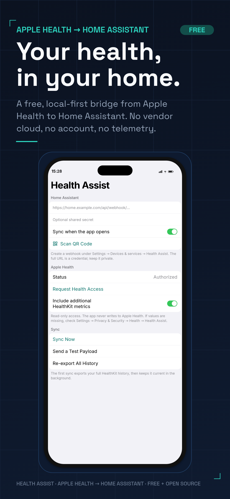
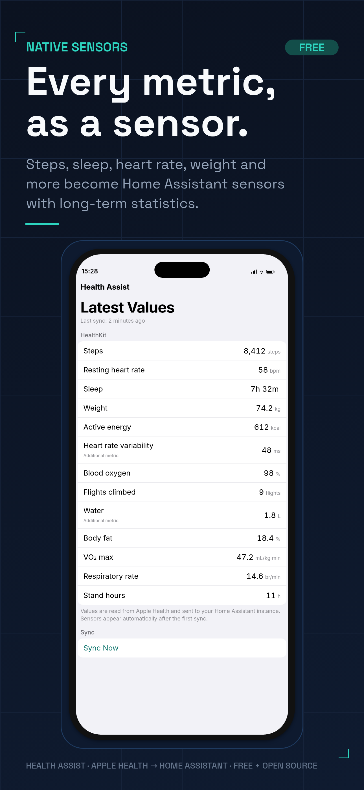
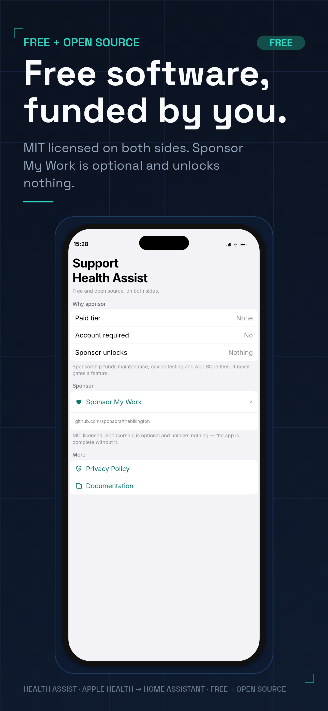

# Health Assist

**Apple Health → Home Assistant, without a cloud service.**

Health Assist is a free, open-source Home Assistant integration and companion
iOS app. The app reads Apple Health with HealthKit and pushes the data over a
local webhook. Home Assistant exposes it as native sensors and long-term
statistics.

## Why

- **Local-first** — no analytics, no telemetry, no vendor cloud.
- **Full history** — the first sync exports all available Apple Health history,
  not just a snapshot.
- **Future updates** — live syncs, hourly HealthKit background delivery and a
  weekly fallback keep the data current.
- **Two phones, one HA** — each iPhone is a separate config entry with its own
  webhook, device and entities.
- **HACS-friendly** — one custom repository, no YAML.

## Quick start

1. [Install the Home Assistant integration](install.md).
2. [Add a device and scan the QR code](setup.md) from the iOS app.
3. Grant Apple Health access and run the first sync.

## Screenshots

  
  
  

[Open the one-pager](screenshots.md).

## Project status

Health Assist is pre-1.2 and actively developed. The webhook and long-term
statistics path are working end to end. Workouts, ECG and clinical records are
not yet exported.

The integration domain remains `apple_health_sync`. The iOS app now uses the
bundle identifier `uk.co.thebillington.applehealthsync`; builds signed with the
old `uk.rebecchi.applehealthsync` identifier are development builds and are not
upgraded in place.

## Repository

- [Home Assistant integration + iOS app](https://github.com/thebillington/health-assist)
- [Report an issue](https://github.com/thebillington/health-assist/issues)
- [MIT license](https://github.com/thebillington/health-assist/blob/main/LICENSE)
- [Privacy policy](privacy.md)

## Sponsor My Work

Health Assist is free, with no paid tier or account. If it saves you time, you
can [sponsor my work on GitHub Sponsors](https://github.com/sponsors/thebillington).
Sponsorship is optional and does not unlock any features.

Apple Health is a trademark of Apple Inc. Health Assist is not affiliated with
or endorsed by Apple.
