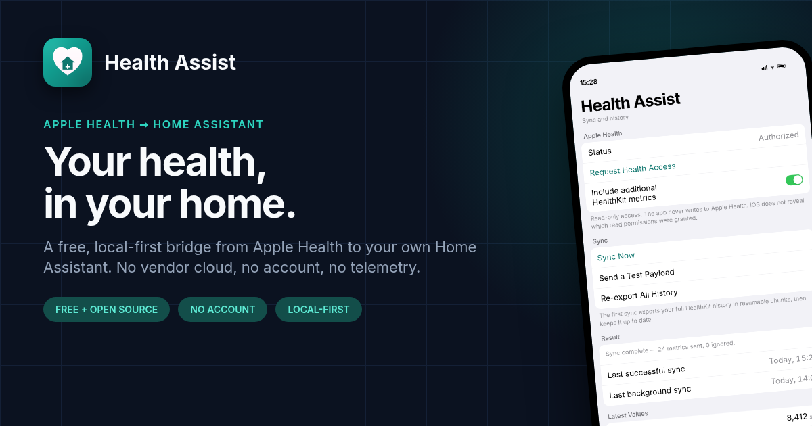

# Screenshots and promotion

All App Store screenshots are 1290 × 2796 (iPhone 6.9", iPhone-only) and are
committed under `docs/images/store/`. They are generated from the technical
mockups in `screenshots/` by the OSG project in `osg/`.

## App Store screenshots

<div style="display:grid;grid-template-columns:repeat(auto-fit,minmax(220px,1fr));gap:28px;margin-top:24px">

<figure>
  
  <figcaption><strong>Your health, in your home.</strong><br>A free, local-first bridge from Apple Health to your own Home Assistant.</figcaption>
</figure>

<figure>
  
  <figcaption><strong>Every record, not just today.</strong><br>Full HealthKit history on the first sync, then background updates.</figcaption>
</figure>

<figure>
  
  <figcaption><strong>Every metric, as a sensor.</strong><br>Native Home Assistant sensors with long-term statistics.</figcaption>
</figure>

<figure>
  
  <figcaption><strong>Your data stays yours.</strong><br>No analytics, no telemetry and no vendor cloud.</figcaption>
</figure>

<figure>
  
  <figcaption><strong>Free software, funded by you.</strong><br>Sponsor My Work is optional and unlocks nothing.</figcaption>
</figure>

<figure>
  
  <figcaption><strong>Scan once. Sync forever.</strong><br>The QR code carries the webhook URL and secret.</figcaption>
</figure>

<figure>
  
  <figcaption><strong>Find it on the App Store.</strong><br>Search “health assist”.</figcaption>
</figure>

<figure>
  
  <figcaption><strong>Built for your home.</strong><br>Free, with no subscription, account or in-app purchases.</figcaption>
</figure>

</div>

## Social card



## Rebuild the set

```bash
python3 osg/make_screens.py
python3 osg/build_project.py
osg render --formats ios-6-9
osg verify
```

Copy the rendered boards to `docs/images/store/` with the names above. The
full copy deck, alt text and social posts are in
[`appstore/PROMOTION.md`](https://github.com/thebillington/health-assist/blob/main/appstore/PROMOTION.md).
